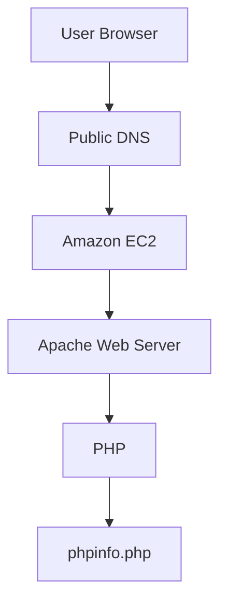

# ☁️ AWS EC2 Web Server Deployment Project

> Deploying and managing a PHP web server on Amazon EC2 using User Data automation, Apache HTTP Server, MariaDB and AWS Systems Manager.

---

## 📌 Project Overview

This project demonstrates how to deploy a web server in AWS using Amazon EC2 and automate the installation of software using User Data scripts.

The project covers:

- EC2 Instance Deployment
- User Data Automation
- Apache Installation
- PHP Configuration
- MariaDB Installation
- Session Manager Access
- EBS Volume Resizing
- Instance Type Modification
- Resource Cleanup

---

## 🛠 Technologies Used

| Technology | Purpose |
|------------|----------|
| Amazon EC2 | Virtual Machine |
| Amazon EBS | Storage |
| Amazon Linux 2023 | Operating System |
| Apache HTTP Server | Web Server |
| PHP 8.5 | Application Runtime |
| MariaDB | Database |
| Session Manager | Secure Remote Access |

---

## 🏗 Solution Architecture

---

## ✅ Final Result

The PHP web application was successfully deployed and accessed through the EC2 public DNS.

images/03-php-test/phpinfo-working.png

---

# Step 1 - Launch EC2 Instance

An Amazon EC2 instance running Amazon Linux 2023 was launched within the EC2-Lab-VPC.

### Instance Configuration

| Setting | Value |
|----------|----------|
| Name | myWebServer |
| Instance Type | t3.micro |
| Operating System | Amazon Linux 2023 |
| Security Group | LabSG |
| Root Volume | 30 GB |

images/01-launch/launch-instance-page.png

---
