# ☁️ AWS EC2 Web Server Deployment Project

> Deploying and managing a PHP web server on Amazon EC2 using User Data automation, Apache HTTP Server, MariaDB, and AWS Systems Manager Session Manager.


---

## 📌 Project Overview

This project demonstrates how to deploy and manage a web server on AWS using Amazon EC2.

The environment was configured using an automated User Data script that installed and configured:

- Apache HTTP Server
- PHP
- MariaDB

Additional tasks included:

- Accessing the instance using Session Manager
- Resizing EC2 compute resources
- Expanding EBS storage
- Testing application availability
- Resource cleanup

---

## 🏗 Solution Architecture

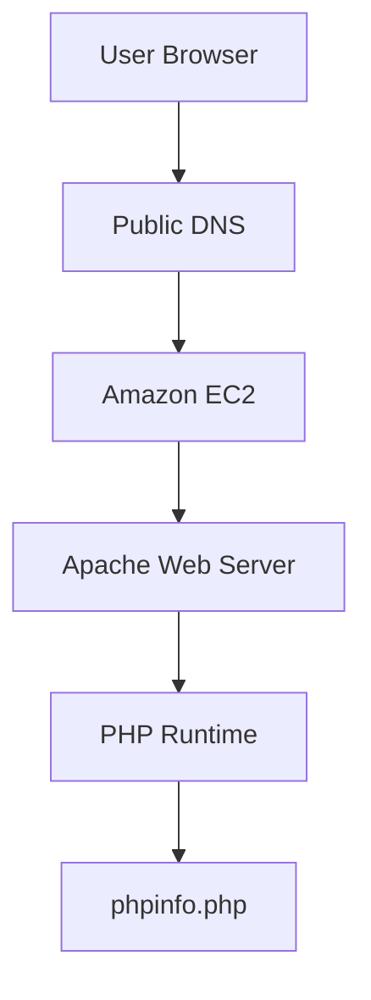

---

## ✅ Final Result

The web server was successfully deployed and verified through the instance Public DNS endpoint.

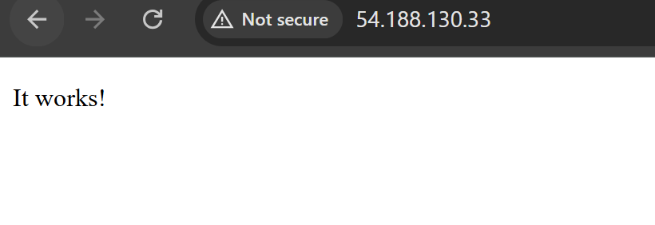

---

# 🚀 Step 1 - Launch EC2 Instance

An Amazon Linux 2023 EC2 instance named **myWebServer** was launched within the lab environment.

### Configuration

| Setting | Value |
|----------|----------|
| Instance Name | myWebServer |
| AMI | Amazon Linux 2023 |
| Instance Type | t3.micro |
| Security Group | LabSG |
| Root Volume | 30 GiB |

### Screenshots

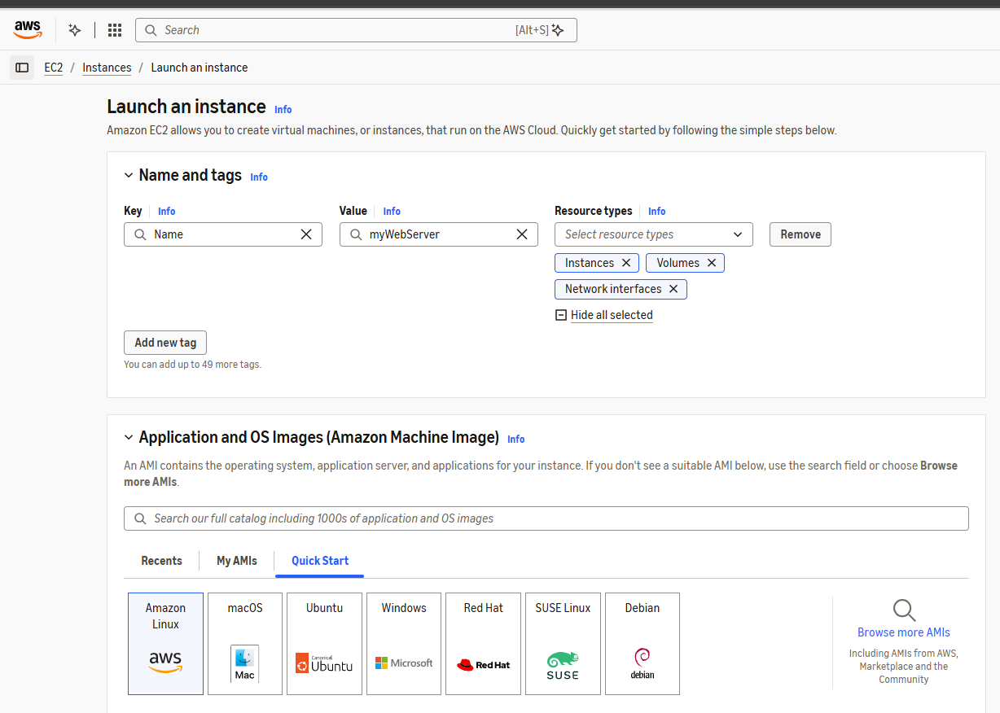

---

# ⚙️ Step 2 - Configure User Data

To automate server setup during launch, a User Data script was provided.

The script automatically:

- Updated system packages
- Installed Apache
- Installed PHP
- Installed MariaDB
- Started the web server
- Created a PHP test page

### User Data Configuration

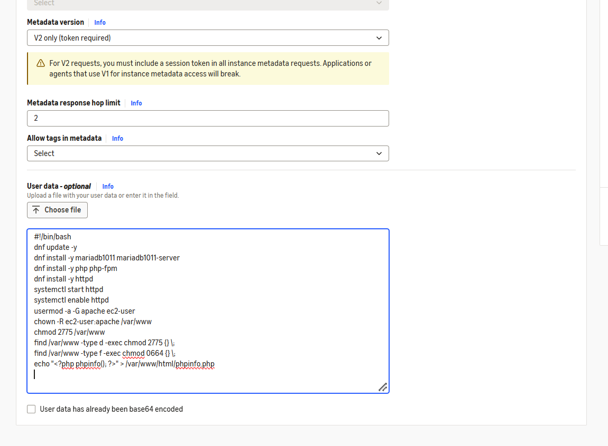

### User Data Script

```bash
#!/bin/bash
dnf update -y
dnf install -y mariadb1011 mariadb1011-server
dnf install -y php php-fpm
dnf install -y httpd

systemctl start httpd
systemctl enable httpd

echo "<?php phpinfo(); ?>" > /var/www/html/phpinfo.php
```

---

# ✅ Step 3 - Test the Web Application

After the instance passed all status checks, the Public DNS endpoint was accessed.

The PHP application loaded successfully, confirming the User Data script had completed correctly.

### Application Output


---

# 🔒 Step 4 - Connect Using Session Manager

AWS Systems Manager Session Manager was used to securely access the EC2 instance without traditional SSH access.

### Session Manager Connection

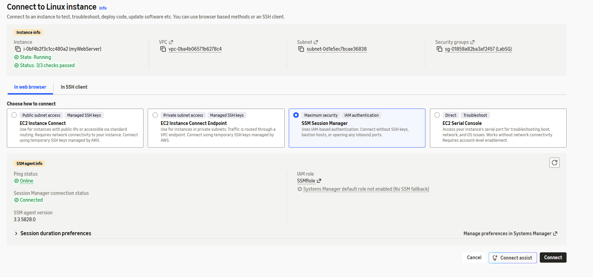

---

# 🐧 Step 5 - Linux Administration

After connecting to the instance, several commands were executed to verify configuration and explore the server.

### Package Update

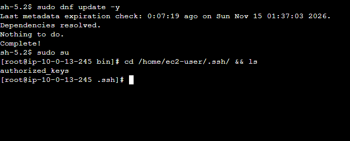

### Authorized Keys


### PHP Application File

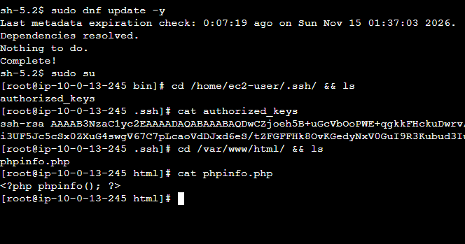

---

# 📈 Step 6 - Modify Instance Resources

The instance was stopped and upgraded from a **t3.micro** to a **t3.small**.

### Instance Resize

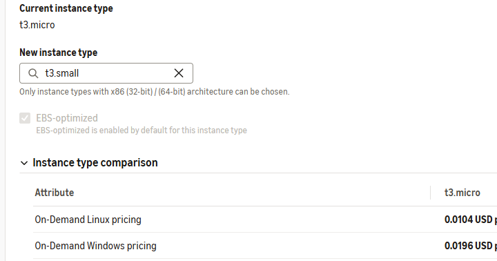

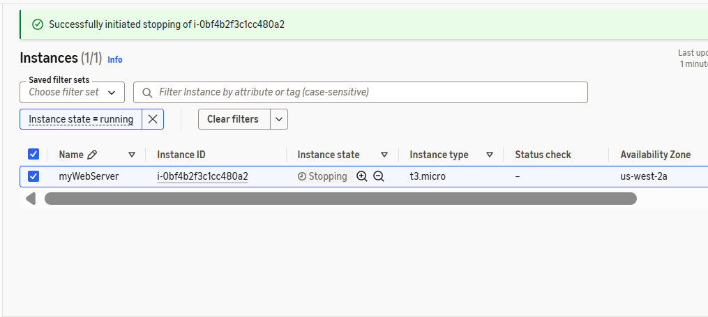

---

# 💾 Step 7 - Expand Storage

The root EBS volume was increased from **30 GB** to **100 GB**.

### Volume Modification

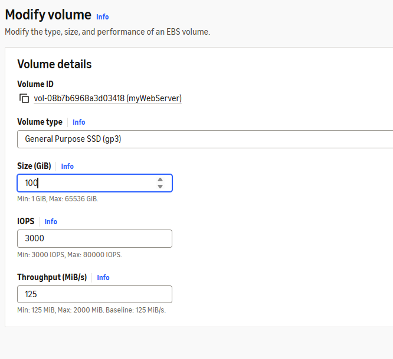

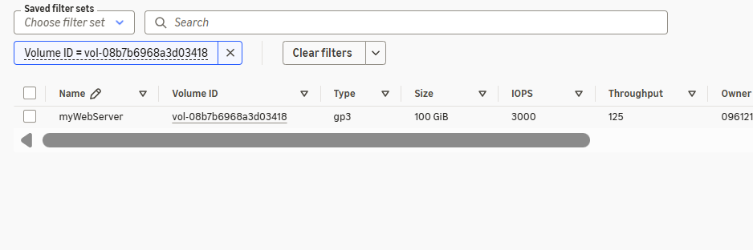

---

# 🗑️ Step 8 - Resource Cleanup

After testing was completed, the EC2 instance was terminated.

### Termination

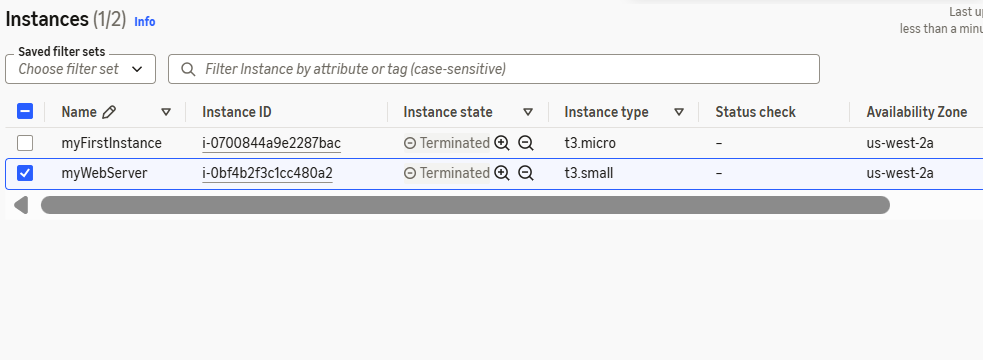

---

# 🎯 Skills Demonstrated

- Amazon EC2
- Amazon EBS
- Amazon Linux 2023
- Apache HTTP Server
- PHP
- MariaDB
- User Data Automation
- Session Manager
- Instance Scaling
- Storage Management
- Linux Administration

---

# 📚 Lessons Learned

Through this project I gained practical experience in:

- Deploying EC2 instances
- Automating server configuration
- Managing Linux servers
- Scaling cloud resources
- Working with AWS storage
- Following the EC2 lifecycle

---

## 👨‍💻 Author

**Lawrence Mphahlele**

ICT Application Development Student

AWS Student Builders Participant

Cloud & Software Development Enthusiast
